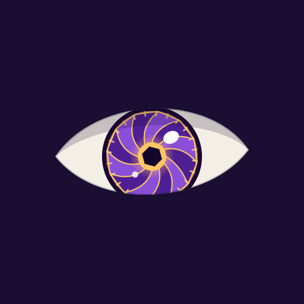

<p align="center">
  
</p>

<h1 align="center">Glimpse</h1>

<p align="center">
  A fast, private photo gallery for Android: a replacement for the Google Photos app that works entirely on your phone.
</p>

<p align="center">
  <a href="https://github.com/wellsey001/Glimpse/releases/latest"></a>
  <a href="https://github.com/wellsey001/Glimpse/actions/workflows/build-apk.yml"></a>
  
</p>

---

## Why Glimpse?

- **Local first.** Glimpse shows what's on your phone and nothing else. There's no account, no cloud and no sign-in.
- **Pairs with Immich.** Leave backups to your own Immich server; Glimpse is just the everyday gallery.
- **Quick.** Thumbnails come from Android's own cache, and the editor prepares photos in the background so it opens instantly.

## Install

1. On your phone, open the **[latest release](https://github.com/wellsey001/Glimpse/releases/latest)** and tap **Glimpse.apk**.
2. If Android asks, allow your browser to *install unknown apps*.
3. Open Glimpse and tap **Allow access** to your photos and videos.

**Make it your default gallery:** open a photo from any app, choose **Glimpse**, then tap **Always**. You can change this later in *Settings → Apps → Default apps*.

Updates install over the top of the old version, keeping your favourites. To be told about new versions, tap **Watch → Custom → Releases** on this page in the GitHub app.

## Features

| | |
|---|---|
| **Photos** | Every photo and video, grouped by day. Pinch the grid to make thumbnails bigger or smaller. |
| **Albums** | One per folder, with Camera and Screenshots first, plus Favourites, Videos and Trash. |
| **Viewer** | Swipe between items, pinch and double-tap to zoom, play videos. Tap to hide the controls. |
| **Organise** | Long-press to select (tap a date to select the whole day), then share, favourite, move to trash, or move/copy to another album or a new one. |
| **Trash** | Uses Android's own trash: items stay for 30 days and can be restored. |
| **Details** | Date, size, resolution, folder, camera, exposure settings and GPS location, with an *Open in maps* button. |
| **Search** | By file name, album, month, year or type. Try `camera june 2024`, `videos`, `favourites` or `screenshots`. |
| **Map** | Geotagged photos on an OpenStreetMap map, grouped into bubbles. Tap one to see the photos taken there. |
| **Edit** | Crop (free or fixed ratios), rotate, flip, brightness, contrast, saturation, warmth and 7 filters. Press and hold to compare with the original. Edits are saved as a copy, so originals are never touched. |

## Permissions and privacy

| Permission | Why |
|---|---|
| Photos and videos | To show your library. On Android 14+ you can choose to share only some photos. |
| Photo location | To read GPS data for the map and the details panel. |
| Internet | Only to download map tiles from OpenStreetMap. Your photos are never uploaded. |
| Media management *(optional)* | Skips Android's confirmation pop-up when you move or delete photos. Turn it on from **⋮ → Skip confirm prompts…** |

Favourites are stored inside Glimpse, which makes tapping the heart instant. They don't sync to Immich or Google.

## Troubleshooting

- **"App not installed"**: Glimpse needs Android 11 or newer. If you installed a build from before 20 November 2026, uninstall it once first, because it was signed with a different key.
- **Blocked by Play Protect**: tap **More details → Install anyway**.
- **Map is empty**: the first visit scans your photos for locations; the progress is shown at the top. Photos taken with location turned off won't appear.

## Building it yourself

Every push to `main` builds a signed APK with GitHub Actions and publishes it under **Releases**. To build locally, open the folder in Android Studio and press **Run**.

<details>
<summary>Tech and project layout</summary>

Kotlin and Jetpack Compose (Material 3, with your wallpaper colours on Android 12+), Coil for images, Media3 ExoPlayer for video, osmdroid for the map, and AndroidX ExifInterface for photo details.

```
app/src/main/java/com/wellsey/glimpse/
  MainActivity.kt         permissions, navigation, system confirm dialogs
  data/                   MediaStore access, favourites, thumbnails, EXIF and location index
  ui/GalleryViewModel.kt  app state and actions
  ui/screens/             Photos, Albums, Search, Map, Trash
  ui/viewer/              full-screen viewer, zoom, video, details
  ui/editor/              editor, crop frame, colour adjustments
```

Signing uses the `SIGNING_KEYSTORE_BASE64` and `SIGNING_PASSWORD` repository secrets. Without them, builds still work but use a temporary key.
</details>

## More apps

- **[Burrow](https://github.com/wellsey001/Burrow)**: file manager with storage cleanup
- **[Folio for Android](https://github.com/wellsey001/Folio-For-Android)**: PDF reader with signing, forms and highlighting
